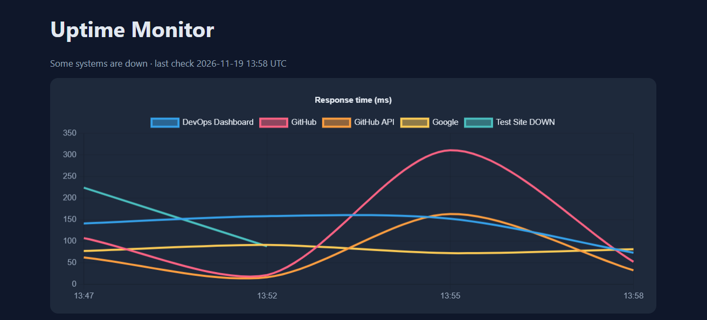
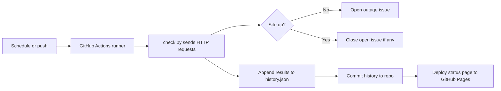

# Uptime Monitor

[](https://github.com/britideepabrahma/uptime-monitor/actions/workflows/uptime.yml)

A serverless uptime monitoring system built with **GitHub Actions** and **Python**. It checks a list of websites on a schedule, tracks uptime and response times, opens incidents automatically when a site goes down, and publishes a live status page, with no servers and no hosting costs.

**Live status page:** https://britideepabrahma.github.io/uptime-monitor/



## Features

- **Scheduled checks**: every site is checked every 6 hours and on every push to `main`
- **Uptime and latency tracking**: records status code and response time, keeping 30 days of history
- **Automated incident management**: opens a GitHub Issue labeled `outage` when a site goes down, then comments and closes it when the site recovers
- **Live status page**: overall status, per-site uptime percentage, history bars, and a response-time chart
- **Zero infrastructure**: runs entirely on GitHub Actions and GitHub Pages

## How it works



1. A GitHub Actions workflow runs on a cron schedule (every 6 hours), on push, or manually.
2. `check.py` reads the site list from `sites.yml`, requests each URL, and measures the response time.
3. Results are appended to `docs/data/history.json`, which is committed back to the repository so history persists between runs.
4. The GitHub REST API is used to open or close outage issues.
5. The `docs` folder is deployed to GitHub Pages, where `index.html` renders the data with Chart.js.

## Tech stack

| Area | Tools |
|------|-------|
| Automation | GitHub Actions (cron schedule, workflow_dispatch) |
| Monitoring logic | Python, requests, PyYAML |
| Incident tracking | GitHub Issues via the REST API |
| Status page | HTML, JavaScript, Chart.js, GitHub Pages |

## Monitored sites

Configured in [`sites.yml`](sites.yml):

```yaml
sites:
  - name: DevOps Dashboard
    url: https://britideepabrahma.github.io/devops-dashboard/
  - name: GitHub
    url: https://github.com
```

To monitor a new site, add an entry and push. The workflow runs automatically.

## Project structure

```
uptime-monitor/
├── check.py                        # Runs checks, saves history, manages incidents
├── sites.yml                       # List of monitored sites
├── docs/
│   ├── index.html                  # Status page
│   └── data/history.json           # Check history (updated by the workflow)
└── .github/workflows/uptime.yml    # Schedule, checks, commit, deploy
```

## Run your own

1. Fork this repository (keep it public).
2. Edit `sites.yml` with the sites you want to monitor.
3. Go to **Settings → Pages** and set **Source** to **GitHub Actions**.
4. Go to **Actions → Uptime check → Run workflow** to run the first check.

Run the checks locally:

```bash
pip install requests pyyaml
python check.py
```

Locally the script updates `history.json` but skips issue creation, since no GitHub token is set.

## Design notes and limitations

- **Check frequency**: GitHub can delay scheduled workflows during busy periods, so checks are approximately, not exactly, every 6 hours. A dedicated monitoring service would be needed for minute-level precision.
- **Single location**: all checks run from GitHub's runners, so the results show availability from one network perspective.
- **History in Git**: storing results in the repository keeps the project serverless and free, at the cost of frequent automated commits. A database or object storage would be the next step at larger scale.
- **Least privilege**: the workflow uses the built-in `GITHUB_TOKEN` with only the permissions it needs (`contents`, `issues`, `pages`).

## Possible improvements

- Notifications via Slack, Microsoft Teams, or email webhooks
- Checking for expected content or SSL certificate expiry, not only status codes
- Multi-region checks